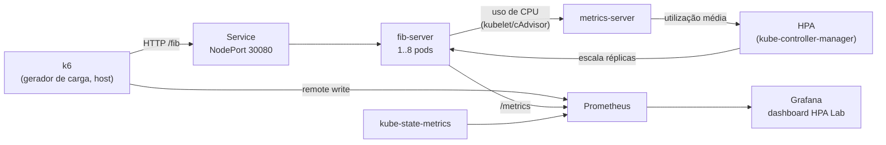
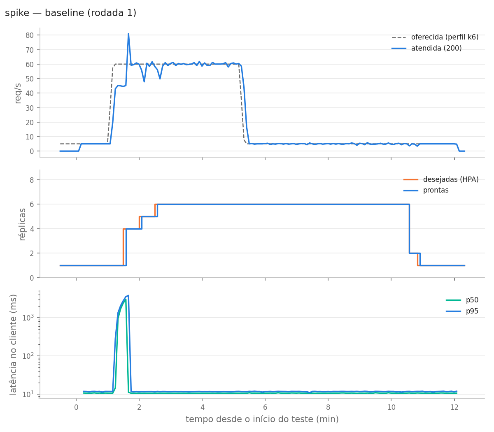
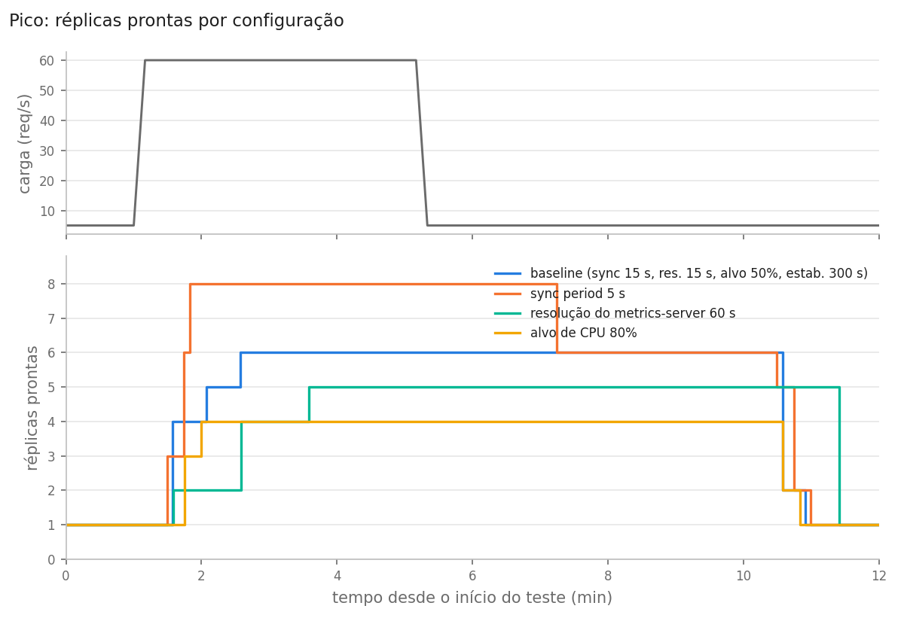
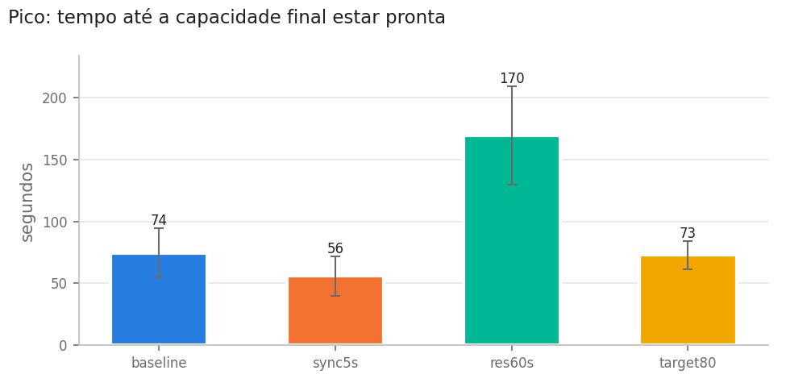
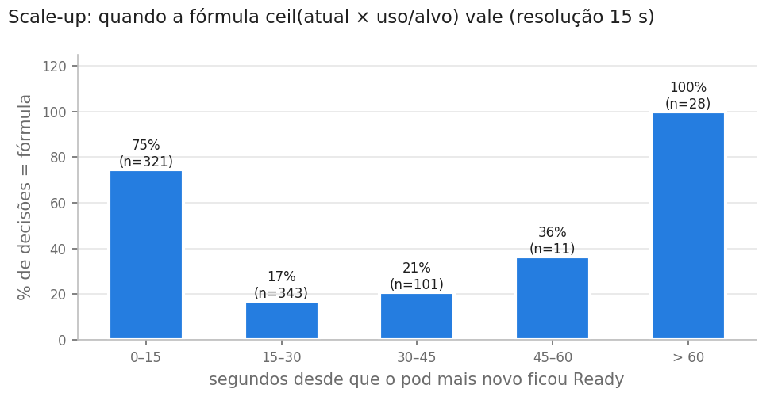
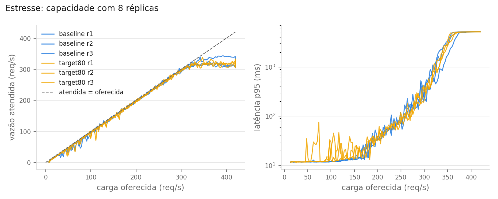
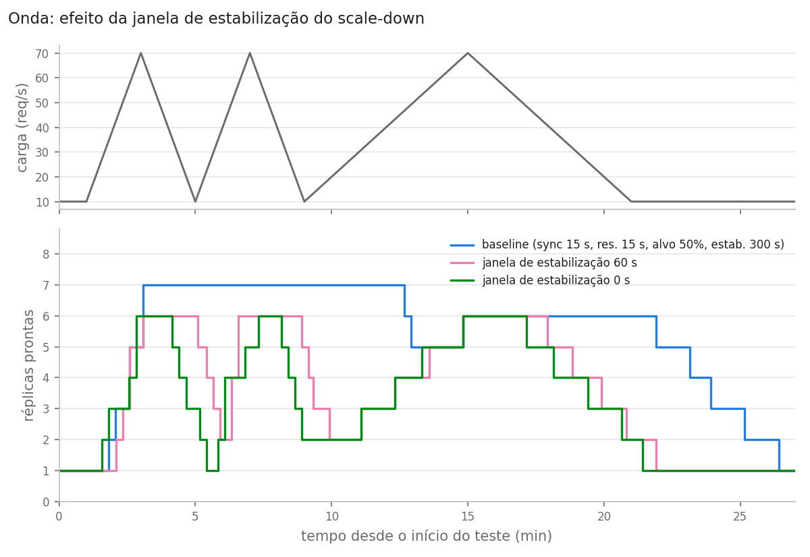

# Avaliação de Desempenho do HPA no Kubernetes

Projeto de MC851 (Unicamp) — **Alícia Gonçalves Vieira, Gabriel Alves de Arruda, Guilherme Brentan de Oliveira e Lucca Pavanatti Duarte**.

Avaliamos o **Horizontal Pod Autoscaler (HPA)** do Kubernetes v1.37 sob três padrões de carga — **pico**, **estresse** e **onda** — usando uma aplicação CPU-bound (Fibonacci em Go), carga gerada com **k6** e observabilidade com **Prometheus + Grafana**. Além da configuração padrão, variamos parâmetros do controlador e da cadeia de métricas e rodamos **30 experimentos automatizados** (10 configurações × 3 repetições, ~10 h). Os resultados foram explicados a partir do código-fonte do controlador do HPA (`pkg/controller/podautoscaler`).

## Principais resultados

| | |
|---|---|
| ⏱️ **Reação a um pico** | O HPA cria os primeiros pods novos em **28 ± 13 s** e chega à capacidade final em **75 ± 20 s**. Os pods ficam prontos em < 1 s: quem domina o tempo é a **coleta de métricas**. |
| 📉 **Coleta de métricas a 60 s** (padrão do addon do Minikube) | Capacidade final em **170 s** e **~10% de falhas** no pico (até 17%), contra 0,7% com 15 s. É a configuração mais prejudicial. |
| 🪜 **Scale-up em degraus** | O HPA sobe 1 → 4 → 5 → 6 em vez de ir direto a 6: pods recém-criados contam como **0% de uso** até terem uma janela completa de métrica, e o *limit* de CPU limita o uso medido a 200%. Fora disso, as decisões batem **100%** com `ceil(atual × uso/alvo)`. |
| 🧱 **Limite de réplicas** | Com 8 réplicas a vazão satura em **~327 req/s**; acima disso só resta fila, latência e timeouts (~22% de falhas no estresse). |
| ♻️ **Scale-down** | A janela de estabilização padrão (300 s) mantém **53%** mais pods que o necessário numa carga oscilante. Com 60 s, só **7%** — **sem nenhuma falha e sem piora de latência**. |

## Arquitetura



| Componente | Configuração |
|---|---|
| Cluster | Minikube v1.39, Kubernetes v1.37.0, driver docker, 1 nó com 6 CPUs e 8 GB |
| Aplicação (`app/`) | Go; `GET /fib` calcula Fibonacci(32) recursivo (~11 ms de CPU); requests 250m / limits 500m; concorrência limitada com fila; métricas Prometheus; graceful shutdown |
| HPA baseline (`k8s/`) | `autoscaling/v2`, 1 a 8 réplicas, alvo de 50% de CPU, padrões do controlador (sync 15 s, tolerância 10%, estabilização de scale-down 300 s) |
| Carga (`load/`) | k6, executor `ramping-arrival-rate` (taxa fixa, independente das respostas), sem reuso de conexão, timeout de 5 s |
| Observabilidade (`observability/`) | kube-prometheus-stack (scrape de 5 s) e dashboard Grafana próprio |

## Cenários e configurações

| Cenário | Perfil de carga | Duração |
|---|---|---|
| **Pico** (`load/spike.js`) | 5 req/s → salto para 60 req/s em 10 s → 4 min sustentado → volta a 5 req/s | 12 min |
| **Estresse** (`load/stress.js`) | rampa de 5 a 420 req/s (além da capacidade de 8 réplicas) e recuperação | 16 min |
| **Onda** (`load/wave.js`) | oscila entre 10 e 70 req/s: 2 ciclos de 4 min + 1 ciclo de 12 min + vale final | 27 min |

| Configuração | O que muda | Cenários |
|---|---|---|
| `baseline` | padrões do Kubernetes | pico, estresse, onda |
| `sync5s` | período de sincronização do HPA de 15 s → 5 s | pico, onda |
| `res60s` | resolução do metrics-server de 15 s → 60 s | pico |
| `target80` | alvo de utilização de 50% → 80% | pico, estresse |
| `stab60` / `stab0` | janela de estabilização do scale-down de 300 s → 60 s / 0 s | onda |

## Resultados

Todos os números são **média ± desvio-padrão de 3 repetições**. Tabelas completas em [`analysis/out/summary.md`](analysis/out/summary.md); dados brutos de cada rodada em [`results/`](results/).

### Pico: quão rápido o HPA reage?



O salto acontece em t = 1 min. A latência dispara enquanto só há 1 pod, e volta a ~11 ms quando a capacidade final fica pronta.

| Config | Reação (s) | Capacidade final (s) | Réplicas | p95 máx. (ms) | Falhas (%) |
|---|---|---|---|---|---|
| baseline | 28 ± 13 | 75 ± 20 | 6 | 3704 | 0,7 ± 1,2 |
| sync5s | 24 ± 3 | 56 ± 16 | 6,7 | 3447 | 0,0 |
| res60s | 64 ± 32 | 170 ± 40 | 5,7 | 4856 | 9,9 ± 8,9 |
| target80 | 42 ± 3 | 73 ± 11 | 4,7 | 5155 | 2,0 ± 0,7 |




- **Sync de 5 s** quase não muda a detecção (o gargalo é a métrica), mas encurta os degraus seguintes — às vezes passando do ponto (8 réplicas).
- **Métricas a 60 s** dobram o tempo de reação e causam timeouts.
- **Alvo de 80%** economiza pods, mas deixa pouca folga: mais latência e ~2% de falhas.

### Por que o HPA sobe em degraus?

O HPA calcula `réplicas = ceil(atual × uso_atual / uso_alvo)`. Comparando com 912 decisões de scale-up registradas:



- Com todos os pods prontos há mais de 60 s, **100%** das decisões seguem a fórmula.
- Logo após um scale-up, só 17–36% seguem. Em `groupPods` (`replica_calculator.go`), um pod com menos de 5 min só tem a métrica considerada se ela foi coletada **uma janela depois de ele ficar pronto**; antes disso, no scale-up, ele conta como **0% de uso**, o que segura o próximo passo.
- O uso é medido em relação ao *request* (250m) e o pod não passa do *limit* (500m = 200%): saindo de 1 pod, o primeiro passo vai no máximo a `ceil(1 × 200/50) = 4`.

### Estresse: o que acontece no limite de réplicas?



| Config | 8 réplicas a partir de | Vazão máxima | p95 > 500 ms a partir de | Timeouts a partir de | Falhas |
|---|---|---|---|---|---|
| baseline | 102 req/s | 327 req/s | 304 req/s | 370 req/s | 22% |
| target80 | 157 req/s | 326 req/s | 316 req/s | 367 req/s | 23% |

O HPA atinge `maxReplicas` muito antes da saturação. A partir daí a vazão acompanha a carga até ~327 req/s e depois só cresce a fila. O alvo muda **quando** o limite é atingido, não a capacidade máxima. Nenhum container reiniciou em toda a bateria.

### Onda: o cluster libera recursos sem prejudicar a aplicação?



| Janela de scale-down | Pods acima do ideal | Eventos de escala | Falhas | p95 |
|---|---|---|---|---|
| 300 s (padrão) | **+53%** | 11 | 0% | 11 ms |
| 60 s | **+7%** | 23 | 0% | 11 ms |
| 0 s | −5% | 29 | 0% | 11 ms |

Com a janela padrão, o HPA mantém as réplicas do pico durante os vales de ciclos menores que 5 min. Janelas curtas eliminam o desperdício sem prejudicar a disponibilidade nesta aplicação — o custo é escalar 2–3× mais vezes, o que pesaria para aplicações com startup lento.

### Lições de engenharia

- **A aplicação precisa aguentar a sobrecarga para o HPA funcionar.** Na primeira versão, sem limite de concorrência, as probes falhavam sob carga, os pods saíam do balanceamento, containers eram reiniciados e o HPA travava (pods não prontos contam como 0%). Com uma fila na aplicação e probes tolerantes, as falhas caíram de 18,5% → 0% (pico) e 62% → 7,6% (estresse).
- **Balanceamento é por conexão TCP:** com keep-alive, pods novos podem ficar ociosos sem o HPA perceber.
- **Confira a coleta de métricas:** o addon do metrics-server do Minikube usa 60 s (upstream: 15 s) e volta a esse valor a cada reinício do cluster.

## Como rodar

### Pré-requisitos

Docker, [Minikube](https://minikube.sigs.k8s.io/), kubectl, Helm, [k6](https://k6.io/) e Python 3 com pandas e matplotlib (para a análise). A máquina precisa de pelo menos 6 CPUs e 8 GB de RAM livres para o cluster.

### 1. Subir o cluster e a aplicação

```bash
scripts/setup-cluster.sh
```

Cria o perfil `hpa` do Minikube (6 CPUs, 8 GB, Kubernetes v1.37.0), aplica o limite de CPU no container do nó, habilita o metrics-server com resolução de 15 s, builda a imagem `fib-server` e aplica namespace, Deployment, Service e HPA baseline.

### 2. Subir Prometheus e Grafana

```bash
scripts/setup-observability.sh
```

- Grafana: `http://$(minikube -p hpa ip):30030` (admin / admin) → dashboard **HPA Lab — fib-server**
- Prometheus: `http://$(minikube -p hpa ip):30090`

### 3. Rodar um teste de carga

```bash
load/run.sh spike                      # ou stress / wave
TIME_SCALE=0.1 load/run.sh spike       # versão comprimida (~1 min) para testar o ambiente
```

Acompanhe pelo dashboard do Grafana e por `kubectl -n hpa-lab get hpa -w`.

### 4. Rodar um experimento completo ou a bateria inteira

```bash
scripts/run-experiment.sh spike baseline 1   # uma rodada: configura, reseta, roda o k6 e exporta para results/
scripts/run-matrix.sh                        # as 30 rodadas (~10 h, retomável)
scripts/run-matrix.sh 'wave_stab'            # só as rodadas que casam com o filtro
```

Cada rodada garante a configuração (HPA, sync period do controller-manager e resolução do metrics-server), volta a aplicação para 1 réplica ociosa, roda o cenário e salva em `results/<cenário>_<config>_r<rep>/` as séries temporais, o ciclo de vida dos pods, os eventos e os metadados.

### 5. Gerar as tabelas e os gráficos

```bash
python3 analysis/analyze.py    # → analysis/out/ (tabelas) e analysis/figs/ (gráficos)
```

## Estrutura do repositório

```
app/             aplicação Go (fib-server) + Dockerfile
k8s/             namespace, Deployment, Service e variantes do HPA
load/            cenários do k6 (spike, stress, wave) e script de execução
observability/   valores do kube-prometheus-stack, ServiceMonitor e dashboard Grafana
scripts/         setup do cluster/observabilidade, execução e exportação dos experimentos
results/         dados brutos das 30 rodadas
analysis/        script de análise, tabelas (out/) e gráficos (figs/)
```

## Limitações

- Cluster de **um único nó** em máquina local: os pods disputam as mesmas CPUs, e o k6 roda no mesmo host.
- Aplicação idealizada (startup < 1 s, custo constante por requisição); aplicações com startup lento sofreriam mais com o atraso do HPA.
- Avaliamos apenas HPA por **CPU** (sem memória ou métricas customizadas) e 3 repetições por configuração.
